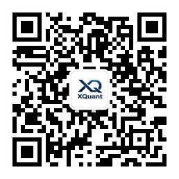

# AI 量化交易入门：《人人都是量化交易员》开源书

用 AI 编程工具和 Python，从零跑通策略回测、风险评估与因子研究。

《XQuant：人人都是量化交易员》采用 Vibe Coding（氛围编程）的
学习方式：不用先学完 Python，再开始学习量化。你会先描述投资想法，
让 AI 辅助生成和运行代码，再用数据验证策略是否站得住。

这是一本面向零基础读者的量化交易自学开源书。你不需要先成为
程序员，也不需要一开始就掌握复杂金融模型。本书会带你用 AI
编程工具和 Python，把一个投资想法写成可执行规则，再用数据、
回测和复查判断它是否站得住。

核心目标很简单：从零跑通一条完整的量化研究路径。

- 提出一个投资想法
- 写成清楚的策略规格说明书，也就是 spec
- 让 AI 辅助生成和运行 Python 代码
- 获取数据并完成策略回测
- 对比基准、评估收益和风险
- 检查过拟合、数据泄露和参数幻觉
- 逐步理解交易执行、监控迭代和因子研究

## 在线阅读

开源书稿在线阅读：

[https://xingwudao.github.io/xquant-beginner/](https://xingwudao.github.io/xquant-beginner/)

最新书稿已更新至 XQuant 量化课堂页。想阅读最新版官方书稿，
请前往图书页：

[https://xquant.shop/courses](https://xquant.shop/courses)

课程、正式书和后续更新也会放在主站：

[https://xquant.shop/courses](https://xquant.shop/courses)

如果您不会写代码、不想阅读全书，也可以看看组合商店：

[https://xquant.shop/products](https://xquant.shop/products)

## 适合谁

本书主要适合三类读者：

- 想入门量化交易，但不知道从哪里开始
- 想自学 Python 量化，却被代码、环境和报错卡住
- 看过很多策略文章，但还没有形成系统的回测和评估方法

它不是“稳赚策略合集”，也不是高频交易教程。本书更关注普通投资者
怎样用 AI、数据和清楚的实验流程，验证自己的投资想法。

## 你会学到什么

本书围绕 9 个问题展开：

- 准备工作：AI 编程工具和 Python 环境怎么搭
- 第 1 章：量化交易怎么赚钱，如何跑通第一个策略
- 第 2 章：买什么，如何构建候选标的池
- 第 3 章：买多少，如何做权重分配和仓位管理
- 第 4 章：什么时候买卖，如何制定交易规则
- 第 5 章：怎么知道策略有效，如何评估回测结果
- 第 6 章：如何避免自欺欺人，如何识别过拟合
- 第 7 章：如何真正执行，从回测走向交易
- 第 8 章：如何持续改进，如何监控、诊断和迭代
- 第 9 章：量化交易的日常是什么，如何入门因子研究

完整目录见 [SUMMARY.md](SUMMARY.md)。

## 配套练习仓库

本仓库存放可发布的书稿源码、图片和发布配置。

书中配套的 spec 与 notebook 不放在这里，统一维护在：

[https://github.com/xingwudao/xquant-learning](https://github.com/xingwudao/xquant-learning)

阅读正文时，如果看到类似 `q1-how-to-profit/specs/` 的路径，
请到 `xquant-learning` 仓库中查看对应文件。

## 快速入口

- 在线阅读：[https://xingwudao.github.io/xquant-beginner/](https://xingwudao.github.io/xquant-beginner/)
- 课程与正式书信息：[https://xquant.shop/courses](https://xquant.shop/courses)
- 配套练习：[https://github.com/xingwudao/xquant-learning](https://github.com/xingwudao/xquant-learning)
- 书稿反馈：[https://github.com/xingwudao/xquant-beginner/issues/new/choose](https://github.com/xingwudao/xquant-beginner/issues/new/choose)
- 读者群：添加作者微信 `xquanter`，备注 `XQuant 读者`

## 作者与服务

### 刑无刀

本文作者 @刑无刀。《机器学习：实用案例解析》译者，《推荐系统》
作者，极客时间《推荐系统 36 式》专栏作者，开源书《人人都是
量化交易员》作者，15 年 AI 从业经验，贝壳（纽交所 + 港交所
双重上市公司，股票代码 BEKE/2423）前技术总监。

- 公众号：刑无刀
- 小红书：刑无刀


### MatrixSpk

本文作者 @MatrixSpk，多年财务及投资经验，系北大 MBA，
公众号「i锐角」主理人。

- 公众号：i锐角


### XQuant-Shop

XQuant-Shop 是面向全球个人投资者的一站式量化投资决策平台，
简称 XQuant 平台。XQuant 平台集成标准化量化数据可视化看板、
零门槛策略搭建工具与自动化工作流体系，帮助普通投资者快速搭建
专属量化投资策略。

- 服务号：XQuant-Shop



## 在线发布

本仓库支持两种发布方式：

- GitBook：通过 `.gitbook.yaml`、`README.md`、`SUMMARY.md` 同步发布
- 静态网页：通过 VitePress 构建为纯静态站点

## 本地预览静态站点

先安装 Node.js，然后运行：

```bash
npm install
npm run docs:dev
```

构建静态站点：

```bash
npm run docs:build
```

预览构建结果：

```bash
npm run docs:preview
```

检查 SEO 构建信号：

```bash
npm run seo:check
```

构建产物位于 `.vitepress/dist/`。

## 反馈与读者群

如果你发现错别字、概念不清或实验结果不一致，请提交 Issue：

[https://github.com/xingwudao/xquant-beginner/issues/new/choose](https://github.com/xingwudao/xquant-beginner/issues/new/choose)

参与反馈前建议阅读：

[CONTRIBUTING.md](CONTRIBUTING.md)

添加作者微信 `xquanter` 进入读者群。请备注：`XQuant 读者`。

## 许可证

本仓库采用双许可证：

- 书稿正文与图片：`CC BY-NC-SA 4.0`
- 构建脚本、配置文件和自动化工作流：`MIT`

也就是说，你可以在署名、非商业、相同方式共享的前提下传播和改编
书稿内容；构建相关代码和配置可按 MIT 许可证使用。

## 风险提示

本书只用于教育和研究，不构成投资建议。历史表现不代表未来收益，
任何策略都可能亏损。
